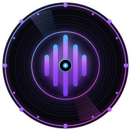
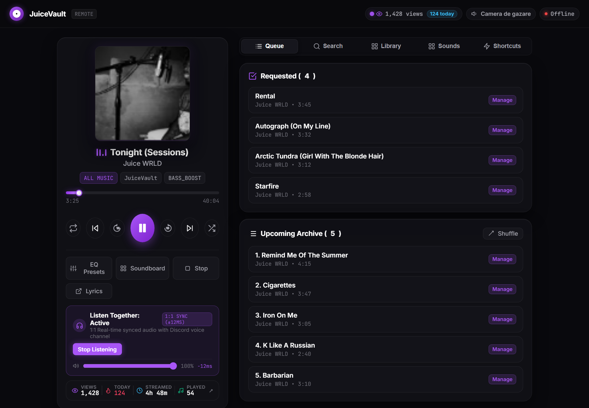
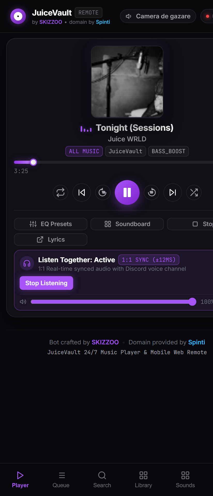
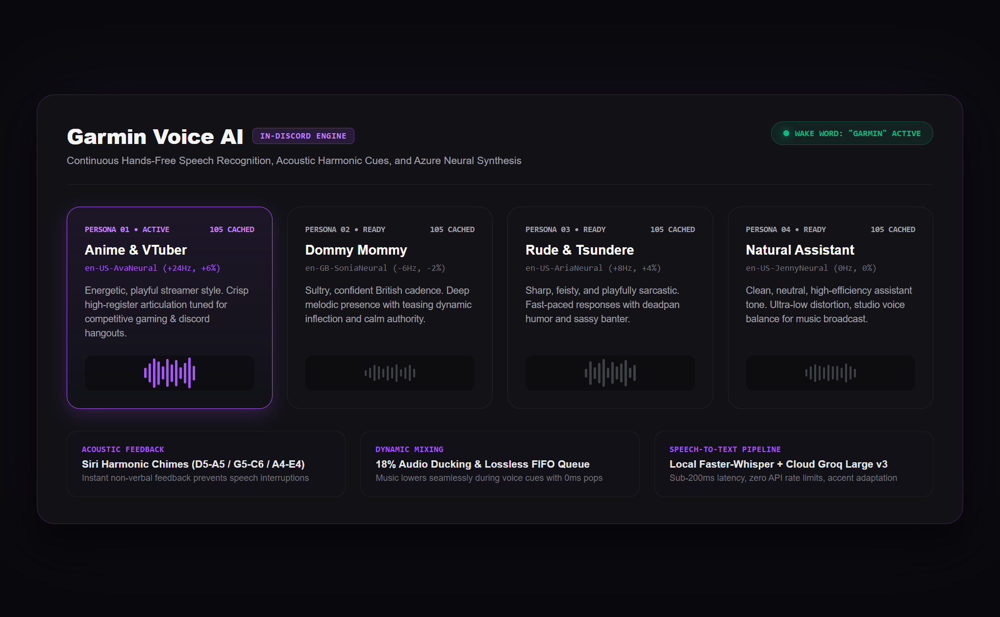
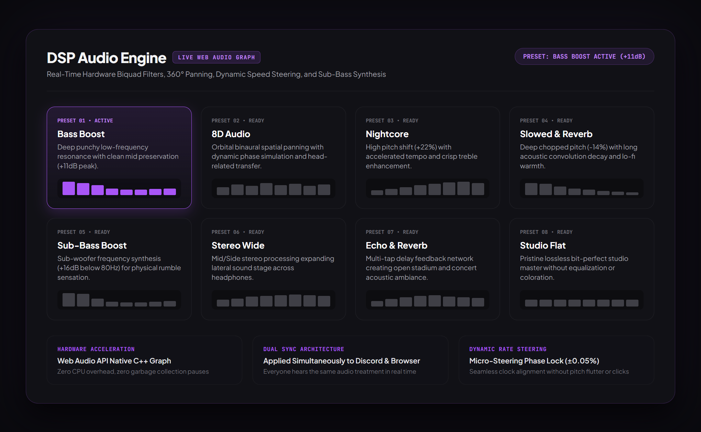
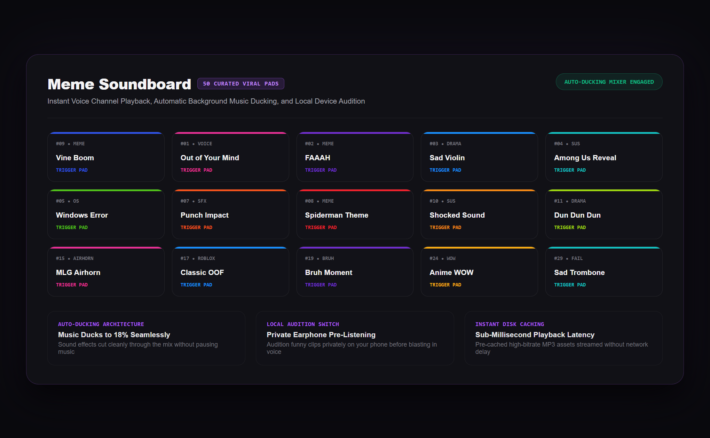
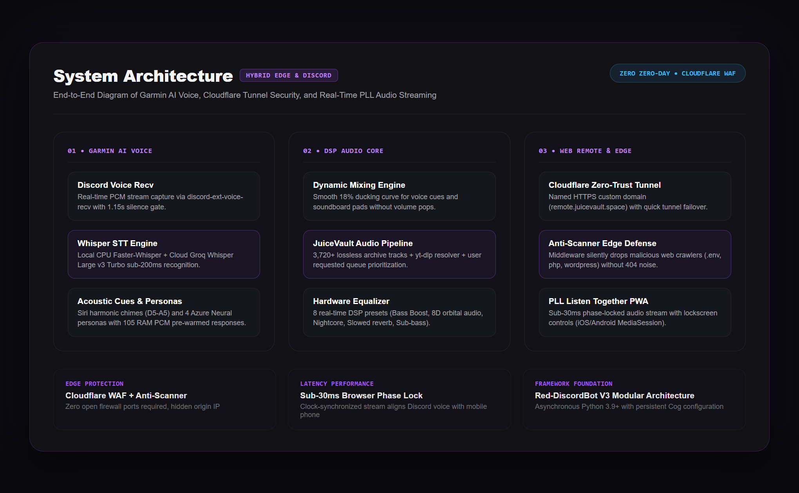

# Red JuiceVault

<p align="center">
  
</p>

<p align="center">
  <strong>High-Performance 24/7 Music Streaming Engine, Garmin Voice AI Assistant, and Progressive Web Remote for Red-DiscordBot</strong>
</p>

<p align="center">
  <a href="https://github.com/Cog-Creators/Red-DiscordBot"></a>
  <a href="https://www.python.org/"></a>
  <a href="https://discordpy.readthedocs.io/"></a>
  <a href="https://www.cloudflare.com/"></a>
  <a href="LICENSE"></a>
  <a href="https://sosocial.lol/ski"></a>
  <a href="https://sosocial.lol/spinti"></a>
</p>

---

## Overview

Red JuiceVault is an enterprise-grade music streaming cog and ecosystem built for **Red-DiscordBot (V3)**. Designed for lossless 24/7 archive playback, interactive voice channel entertainment, and seamless remote management, JuiceVault integrates continuous speech recognition, real-time digital signal processing (DSP), zero-latency local caching, and an installable Progressive Web App (PWA) remote controller.

Whether streaming from the 3,720+ track unreleased Juice WRLD catalog, queuing YouTube playlists, triggering viral soundboard pads over active playback, or commanding the bot hands-free via Discord voice, JuiceVault delivers studio-grade acoustics and edge-protected network stability.

---

## Architectural Showcase

### Desktop Web Remote Interface
A glassmorphic, kinetic dark dashboard with real-time WebSocket state synchronization, queue management, visualizer engine, and hardware controls.

<p align="center">
  
</p>

### Listen Together & Mobile Progressive Web App
Sub-30ms phase-locked audio streaming directly to browser clients with lockscreen media session integration and low-latency hardware volume adjustment.

<p align="center">
  
</p>

### Garmin AI Voice Assistant & 4 Neural Personas
Hands-free voice recognition in Discord channels powered by Whisper STT, Siri harmonic acoustic cues, 0ms RAM PCM playback cache, and 4 distinct Azure Neural personalities.

<p align="center">
  
</p>

### Hardware DSP Equalizer & Audio Engine
Real-time 8-preset audio filtering graph applying 8D orbital spatial panning, dynamic Bass Boost, Nightcore acceleration, Slowed lo-fi decay, and Sub-Bass rumble simultaneously across Discord and browser streams.

<p align="center">
  
</p>

### 50 Meme Soundboard with Dynamic Music Ducking
Instantaneous soundboard execution with automatic 18% background music ducking and private local auditioning.

<p align="center">
  
</p>

### System Architecture & Security Pipeline
End-to-end integration diagram illustrating Cloudflare Zero-Trust tunneling, anti-scanner WAF protection, local faster-whisper speech recognition, and Red-DiscordBot audio streaming.

<p align="center">
  
</p>

---

## Key Features

### [VOICE AI] Garmin Hands-Free Voice Control
- **Wake Word Detection ("Garmin" / "Hey Garmin")**: Speak naturally inside any Discord voice channel without touching a keyboard or device.
- **Siri-Style Acoustic Feedback**: Crystalline synthesized harmonic cues confirm assistant state without cutting across spoken audio:
  - *Listening Chime* (D5 -> A5): Confirms wake word detection.
  - *Understood Chime* (G5 -> C6): Confirms successful command parse.
  - *Error Chime* (A4 -> E4): Notifies unrecognized speech or system error.
- **15-Second Wake Window & 1.15s Silence Gate**: Generous natural pauses allow fluid command formulation without premature cutoff.
- **4 Distinct Azure Neural Personas**:
  - `anime`: Energetic, youthful streamer tone (Microsoft Ava Neural, +24Hz pitch, +6% rate).
  - `mommy`: Confident, melodic British cadence (Microsoft Sonia Neural, -6Hz pitch, -2% rate).
  - `rude`: Sarcastic, sharp tsundere assistant (Microsoft Aria Neural, +8Hz pitch, +4% rate).
  - `natural`: Neutral, clean studio voice for professional broadcast (Microsoft Jenny Neural, 0Hz, 0%).
- **0ms RAM PCM Pre-Warming**: Over 105 core system phrases, volume levels, and error states are pre-synthesized into raw 48kHz 16-bit stereo PCM in memory at startup, eliminating TTS generation delays.
- **Dynamic 18% Music Ducking & Lossless FIFO Queue**: Background music ducks smoothly to 18% during assistant speech and soundboard triggers, restored automatically via a non-blocking queue.
- **Multi-Tier Speech Recognition**:
  - *Tier 1*: Offline local `faster-whisper` running on CPU/RAM with zero API costs.
  - *Tier 2*: Free Google STT engine for passive chatter filtering.
  - *Tier 3*: Cloud Groq Whisper Large v3 Turbo for ultra-low latency command execution.
- **Accent Adaptation**: Built-in pronunciation alias registry adapts to dialect variations and custom wake triggers.

### [REMOTE] Mobile PWA & Real-Time Web Gateway
- **OriginKit & Kinetics UI Design**: Pure SVG iconography, zero emojis, dark zinc/obsidian surfaces, and physics-based tactile transitions.
- **Sub-30ms Listen Together Audio Sync**: Phase-Locked Loop (PLL) engine streams active Discord voice audio directly to web browsers in synchronized lockstep.
- **Mobile Lock Screen Integration**: Complete `MediaSession` API support allows track scrubbing, play, pause, and skips directly from the iOS Dynamic Island, Android notification shade, or Bluetooth accessories.
- **Interactive Queue Controller**: Reorder, jump, prioritize, or purge items from active playback and user-submitted requests.
- **Audio-Reactive Visualizer Engine**: Canvas-driven visualizer featuring Aurora Waves, Quantum Starfield, Retro Synthwave Grid, and Analog Dual VU ballistic meters.
- **Telemetry & Round-the-Clock Metrics**: Persistent tracking of total listening hours, daily unique visits, active WebSocket sessions, and song completions.

### [SECURITY] Cloudflare Edge Protection & Network Isolation
- **Cloudflare Zero-Trust Named Tunnels**: Map custom domains (such as `remote.juicevault.space`) to the local Web Remote without exposing public IP addresses or port forwarding.
- **Automated 1-Click Quick Tunnels**: Spin up ephemeral `*.trycloudflare.com` endpoints instantly for remote testing.
- **Anti-Scanner Middleware**: Proactively identifies and drops unauthorized scanners (`.env`, `phpinfo`, `wp-admin`, `service_account.json`, `robots.txt`) with zero socket allocation or log spam.
- **Local Fallback HTTPS**: Integrated 2048-bit self-signed SSL certificate generator for direct port deployments.

### [AUDIO CORE] DSP Equalizer & Soundboard
- **8 Hardware Equalizer Presets**: Web Audio API BiquadFilter graph processing Flat, Bass Boost (+11dB), 8D Audio orbital spatializer, Nightcore (+22% rate/pitch), Slowed & Reverb (-14% lo-fi), Sub-Bass (+16dB below 80Hz), Stereo Wide, and Echo/Reverb.
- **50 Curated Viral Soundboard Pads**: Rapid-fire execution of viral audio memes directly into Discord voice with private local earphone auditioning.
- **Personal Favorites**: Instant bookmarking of archive tracks and YouTube sources (`[p]jv favorite`, `[p]jv playfav`).
- **VIP Entrance Audio Themes**: Automated greeting audio with ducked music when designated server VIPs connect to voice.

---

## Voice Commands Reference

Activate Garmin by speaking **"Hey Garmin"** or **"Garmin"**, followed immediately or within 15 seconds by any command:

| Functional Category | Spoken Voice Commands |
| :--- | :--- |
| **Playback Control** | *"skip"*, *"next"*, *"skip this song"*, *"skip 10"*, *"previous"*, *"restart"*, *"pause"*, *"resume"*, *"stop"* |
| **Seeking & Scrubbing** | *"forward 10"*, *"skip 10s"*, *"back 10"*, *"rewind 10"* |
| **Volume Adjustment** | *"volume 80"*, *"set volume to 50%"*, *"louder"*, *"quieter"*, *"mute"*, *"unmute"* |
| **Queue & Mode** | *"shuffle"*, *"random"*, *"loop"*, *"repeat"*, *"toggle loop"* |
| **Track Information** | *"what's playing?"*, *"what is this song?"*, *"who sings this?"*, *"song info"* |
| **Personal Favorites** | *"save this song"*, *"add to favorites"*, *"play one of my favorite songs"*, *"remove from favorites"* |
| **Catalog & Search** | *"play robbery"*, *"play Yeat"*, *"play Carti"*, *"search YouTube for \<query\>"* |
| **Persona Selection** | *"switch to anime voice"*, *"switch to mommy voice"*, *"switch to rude voice"*, *"switch to natural voice"* |
| **Session Control** | *"help"*, *"what can you do?"*, *"leave"*, *"disconnect"*, *"bye"* |

---

## Discord Command Reference

Default command prefix: `[p]` (e.g. `!jv` or `4jv`)

### Playback & Queue Management
```text
[p]jv start                       Start 24/7 archive playback in your voice channel
[p]jv stop                        Stop playback, clear queue, and leave voice
[p]jv play <query | URL>          Stream specific vault track, YouTube video, or full playlist
[p]jv skip                        Skip the currently playing track (alias: next)
[p]jv skip10                      Advance queue by 10 tracks
[p]jv previous                    Return to the previously played track
[p]jv rewind10                    Jump backward 10 seconds in current track
[p]jv shuffle                     Randomize remaining tracks in active queue
[p]jv volume <0-150>              Set music output volume (alias: vol)
[p]jv status                      Display active stream statistics and DSP status
[p]jv lyrics                      Retrieve and display synchronized lyrics
```

### Personal Favorites System
```text
[p]jv favorite                    Save currently playing track to personal profile (alias: fav, like)
[p]jv favorites                   List all saved personal favorites (alias: favs, likes)
[p]jv playfav                     Queue and play a random track from personal favorites (alias: pf)
```

### Garmin Voice AI Configuration
```text
[p]jv vc <on|off>                 Toggle live in-Discord voice recognition
[p]jv persona <anime|mommy|rude|natural>  Set active voice persona
[p]jv vclearn <phrase>            Map an accent or custom pronunciation to wake word
[p]jv vclearned                   List all learned accent mappings
[p]jv groq <api_key>              (Owner) Configure Groq Whisper API key for low-latency STT
[p]jv installvc                   (Owner) Install optional voice recognition dependencies
```

### Web Remote & Network Tunneling
```text
[p]jv remote                             Display remote URL, authentication token, and QR code
[p]jv remote url <https://domain>        Bind custom domain address (e.g. https://remote.juicevault.space)
[p]jv remote tunnel token <token>        Start persistent Cloudflare Named Tunnel via token
[p]jv remote tunnel                      Spin up free 1-click Cloudflare Quick Tunnel (*.trycloudflare.com)
[p]jv remote tunnel stop                 Terminate active Cloudflare tunnel process
[p]jv remote tunnel clear                Purge saved tunnel token and stop service
[p]jv remote https [on|off]              Toggle self-signed SSL encryption on direct port
[p]jv remote port <port>                 Configure web server listening port (default: 8088 / 2556)
[p]jv remote token [new_token]           Inspect or regenerate secret remote authentication token
[p]jv remote restart                     Restart internal aiohttp server and WebSocket gateway
```

### Catalog & Archives
```text
[p]jv categories                  List available catalog categories
[p]jv category <name>             Switch active collection (Released, Instrumentals, Remasters, etc.)
[p]jv search <query>              Search JuiceVault archive and append match to queue
[p]jv refresh                     Purge local cache and sync catalog from upstream API
```

---

## Installation & Setup

### 1. Prerequisites
- Python 3.9 or higher
- [Red-DiscordBot V3](https://github.com/Cog-Creators/Red-DiscordBot) instance
- [FFmpeg](https://ffmpeg.org/) installed and available in the operating system `PATH`
- Cloudflared binary (optional, managed automatically for Cloudflare tunnels)

### 2. Cog Installation
Run the following commands in your Discord server:

```text
[p]repo add juicevault https://github.com/SKIZZOO/red-juicevault
[p]cog install juicevault juicevault
[p]load juicevault
```

### 3. Voice Dependencies Installation
For full Garmin Voice AI support (local speech recognition, audio capture, and neural voice synthesis):

```text
[p]jv installvc
```

Alternatively, install required packages manually in your Red-DiscordBot virtual environment:
```bash
pip install discord-ext-voice-recv SpeechRecognition edge-tts faster-whisper
```

### 4. Activating Garmin Voice Assistant
Connect to a voice channel and execute:
```text
[p]jv start
[p]jv vc on
```

Say **"Hey Garmin"** to hear the listening chime, then speak your desired command.

---

## Updating

### Via Discord
```text
[p]repo update juicevault
[p]cog update juicevault
[p]reload juicevault
```

### Via Terminal
Navigate to your Red-DiscordBot cog directory:
```bash
git pull origin main
```
Then reload within Discord:
```text
[p]reload juicevault
```

---

## Technical Stack

| Component | Technology | Role |
| :--- | :--- | :--- |
| **Bot Core** | Red-DiscordBot V3 | Asynchronous modular Discord bot architecture |
| **Discord API** | discord.py 2.0+ | Voice channel management, client gateway, and component views |
| **Voice Ingestion** | discord-ext-voice-recv | Raw RTP packet capture and voice stream assembly |
| **Speech-To-Text** | faster-whisper / Groq Cloud | Offline CPU inference and accelerated cloud Whisper Large v3 |
| **Voice Synthesis** | edge-tts | Microsoft Azure Neural text-to-speech engine |
| **Audio Processing** | FFmpeg | Audio transcoding, volume normalization, and real-time ducking |
| **Web Server** | aiohttp | Asynchronous HTTP server and WebSocket state broadcasting |
| **Audio Sync** | Web Audio API | Phase-Locked Loop (PLL) micro-steering for browser streaming |
| **Network Security** | Cloudflare Tunnel / WAF | Hidden-origin HTTPS tunneling and anti-scanner edge filtering |
| **Media Resolution** | yt-dlp | YouTube playlist extraction and remote audio stream resolution |

---

## Contributors & Credits

- **Core Engineering & Architecture**: **SKIZZOO**
  - Website: [sosocial.lol/ski](https://sosocial.lol/ski)
  - GitHub: [@SKIZZOO](https://github.com/SKIZZOO)
- **Domain & Infrastructure Sponsor**: **Spinti**
  - Website: [sosocial.lol/spinti](https://sosocial.lol/spinti)
  - Infrastructure: Provision of `juicevault.space` domain and edge routing

Special acknowledgment to the **JuiceVault** archive curation team, the **Red-DiscordBot** development community, and the **discord.py** maintainers.

---

## License

This project is licensed under the [MIT License](LICENSE).
